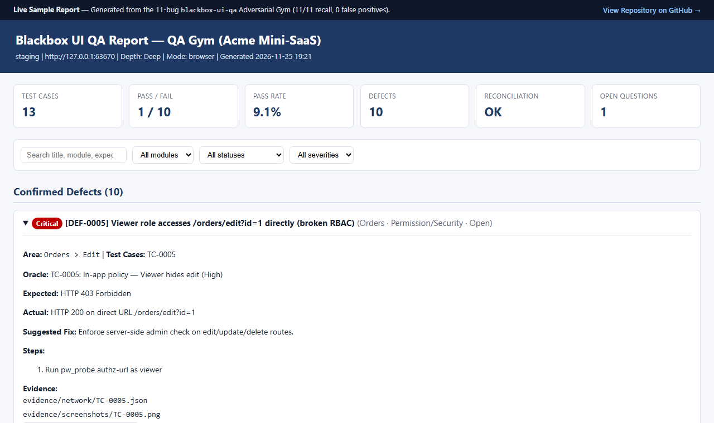
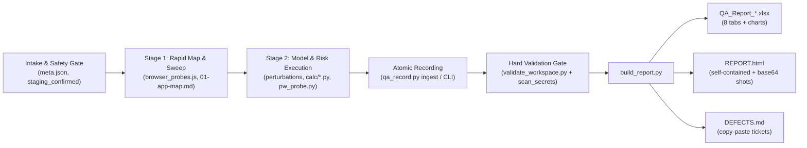

# Blackbox UI QA

**Turn any coding agent into an adversarial, evidence-backed QA engineer for web apps you can only test through the UI.**

[](CHANGELOG.md)
[](LICENSE)
[](requirements.txt)
[](https://affankhan007.github.io/blackbox-ui-qa/)

**[View Live Sample Report](https://affankhan007.github.io/blackbox-ui-qa/)** · **[Sample Deliverables](examples/README.md)** · **[Adversarial QA Gym](evals/gym/server.py)** · **[Changelog](CHANGELOG.md)**

When source code is unavailable, generic AI "QA" turns into shallow button-clicking that misses tax/rounding bugs, reload data loss, async search races, and direct-URL RBAC bypasses—or floods you with false alarms.

`blackbox-ui-qa` installs in one command and gives Claude Code, OpenCode, Codex, Cursor, Windsurf, Gemini, and Copilot an adversarial black-box methodology, SSE-safe browser telemetry, deterministic Playwright probes, a strict secret-scan validator, and three ready-to-ship deliverables.

### One-Line Install & First Run

```bash
npx skills add AffanKhan007/blackbox-ui-qa
```

Then ask your agent:
> Use `blackbox-ui-qa` to audit our staging app at `https://staging.example.com` (staging confirmed). Logins: Admin (`admin@test.com`) and Viewer (`viewer@test.com`). Scope: Orders, Settings, Billing. Forbidden: send real emails or delete non-`QA_` records. Depth: Deep.



---

## Verified Benchmark Scorecard (`evals/gym/`)

Measured against our self-contained, zero-dependency 11-bug + 2-trap [Adversarial QA Gym](evals/gym/server.py) and graded automatically with [`evals/score_gym_run.py`](evals/score_gym_run.py):

| Run Configuration | Scope | Planted-Bug Recall | False-Positive Traps | Validation & Secret Scan | Cleanup |
|---|---|---|---|---|---|
| **Restricted Webview** (`js_eval: false`) | 8-bug baseline | `7 / 8` (`87.5%`) | `0` violations | `0` errors | Restored & clean |
| **`pw_probe.py` + `browser_probes.js` + `ingest`** | 8-bug baseline | **`8 / 8` (`100.0%`)** in `24.13s` | **`0` violations** | **`0` errors** | Restored & clean |
| **Full SPA/AI Gym Suite (`v2.3.0`)** | **11 bugs** (incl. `409` rollback, `?tab=` deep-link, SSE citation) | **`11 / 11` (`100.0%`)** in `36.0s` | **`0` violations** | **`0` errors** | Restored & clean |

---

## Why `blackbox-ui-qa` Beats Ad-Hoc UI Clicking

| Failure Mode of Ad-Hoc AI QA | How `blackbox-ui-qa` Solves It |
|---|---|
| **Trusts the app's own math** | **Oracle before actual:** Computes totals, proration, and rounding externally in `calc/*.py` before judging UI output. |
| **Trusts a green "Saved!" toast** | **7-surface persistence:** Verifies immediate UI, hard reload, sibling lists, downstream modules/reports, exports, audit logs, and network payloads. |
| **Misses 1.5s toasts & GraphQL HTTP 200 errors** | **`browser_probes.js` telemetry:** Attaches `MutationObserver`, SSE-safe `fetch`/XHR hooks, and WCAG 2.2 DOM audits with automatic secret redaction. |
| **Can't catch millisecond race conditions** | **`pw_probe.py` accelerator:** Triggers concurrent search races, double-submits, deep-link reloads, keyboard Tab audits, and isolated-role URL checks. |
| **Cries wolf on ambiguous UX** | **6-way anomaly triage:** Separates `Test artifact`, `Environment/data`, `Expected variant`, `Oracle gap`, and `Observation`—only oracle-backed bugs become `Fail`. |
| **Hand-written, unverified summaries** | **Hard validation gate:** Blocks un-evidenced `Pass`/`Fail`, `0`-byte files, unrestored settings, and leaked tokens/JWTs across `.html`/`.har`/`.json`/`.txt`. |

---

## Workflow & Deliverables



Every validated run generates three synchronized artifacts (or an interactive Excel runbook in `--guided-sheet` mode):

1. **[`REPORT.html`](https://affankhan007.github.io/blackbox-ui-qa/)** — Self-contained, XSS-escaped interactive HTML report with base64-inlined screenshots, KPI cards, and live filters.
2. **[`DEFECTS.md`](examples/DEFECTS.md)** — Severity-sorted (`Critical` → `Enhancement`), copy-pasteable GitHub/Jira/Linear tickets with linked test-case oracles.
3. **[`QA_Report_<app>.xlsx`](examples/demo_report.xlsx)** — Styled 8-sheet workbook (`Summary` with charts & reconciliation, `Test Cases`, `Defects`, `Coverage`, `Field Atlas`, `Relationships`, `Test Data & Config`, `Open Questions`).

Inspect tracked sample outputs in [`examples/`](examples/README.md). To render a local walkthrough video (`assets/demo.webm`, gitignored), run [`assets/record_demo.py`](assets/record_demo.py).

---

## Installation & Depth Modes

**Prerequisites:** Python `3.10+` with `openpyxl>=3.1` (`pip install -r requirements.txt`), plus any browser driver (host browser tool, Playwright MCP, Chrome DevTools MCP, or optional `pip install playwright && playwright install chromium`), or Guided Mode without a browser.

| Method | Command |
|---|---|
| **Universal (`npx skills`)** | `npx skills add AffanKhan007/blackbox-ui-qa` |
| **Linux / macOS** | `git clone https://github.com/AffanKhan007/blackbox-ui-qa.git && cd blackbox-ui-qa && ./install.sh --global --host all` |
| **Windows PowerShell** | `.\install.ps1 -Scope Global -HostName all` |

Supported `--host` / `-HostName` targets: `universal`, `claude`, `opencode`, `codex`, `cursor`, `windsurf`, `gemini`, `copilot`, `all`.

### Depth Modes

| Depth | Rigor & Coverage |
|---|---|
| **`Quick`** | Navigation map, passive error/layout sweep, smoke + top P0 risks (`sampled` atlas). |
| **`Standard`** | Full navigation map, risk-targeted controls, interleaved P0/P1 flows, multi-role checks. |
| **`Deep`** *(default)* | `Standard` **plus** Ring 0/1 cross-module modeling, config perturbations (logged & restored), external `calc/*.py` math checks, 7-surface persistence, `configuration_matrix`, and 1 gap-hunt loop. |
| **`Exhaustive`** | `Deep` **plus** `full` atlas accounting (every control tested or explained), pairwise config interactions, and repeated gap-hunt loops until dry. |

---

## CLI Quick Reference

Core golden path (`scripts/` — pure stdlib except `build_report.py` needing `openpyxl` and optional `pw_probe.py` needing `playwright`):

```bash
python scripts/init_workspace.py --app "Acme HR" --url "https://staging.example.com" --module Payroll --depth deep
python scripts/pw_probe.py <ws> save-auth --login-url <url>/login --user admin --password "..." --out /tmp/qa_admin.json
python scripts/pw_probe.py <ws> exec --storage-state /tmp/qa_admin.json --file steps.json
python scripts/qa_record.py <ws> ingest --file bundle.json
python scripts/validate_workspace.py <ws> --strict
python scripts/build_report.py <ws>
```

<details>
<summary>All Playwright probes, guided round-trip, and diff commands</summary>

```bash
# Playwright probes (auto-injects scripts/browser_probes.js via addInitScript)
python scripts/pw_probe.py <ws> sweep --storage-state /tmp/qa_admin.json --url <url>/orders --url "<url>/orders?tab=confirmed"
python scripts/pw_probe.py <ws> deeplink-check --storage-state /tmp/qa_admin.json --url <url>/orders --click 'button[data-tab="confirmed"]' --expected-url-part tab=confirmed --watch-selector "#orders-tbody"
python scripts/pw_probe.py <ws> a11y-keyboard --storage-state /tmp/qa_admin.json --url <url>/orders --tabs 25
python scripts/pw_probe.py <ws> race-search --url <url>/orders --selector "#order-search" --query-a alpha --query-b beta
python scripts/pw_probe.py <ws> double-submit --url <url>/orders --fill 'input[name="customer"]=QA_DBL' --submit-selector "#create-order-btn"
python scripts/pw_probe.py <ws> reload-check --url <url>/orders/detail?id=1 --fill "#note-input=QA_NOTE" --submit-selector '#note-form button[type="submit"]' --watch-selector "#note-display"
python scripts/pw_probe.py <ws> authz-url --login-url <url>/login --user viewer --password "..." --role viewer --target-url <url>/orders/edit?id=1

# Guided execution sheet round-trip & cross-run diffing
python scripts/build_report.py <ws> --guided-sheet
python scripts/qa_record.py <ws> import-guided --file Guided_Execution_acme-hr.xlsx
python scripts/qa_diff.py <baseline_ws> <current_ws>

# Local 11-bug Adversarial Gym & test suite
python evals/gym/server.py --port 8765
python evals/score_gym_run.py <workspace> --json
python examples/make_demo.py
python tests/check_skill.py
python tests/smoke_test.py
```

</details>

```text
blackbox-ui-qa/
├── SKILL.md                             # Core skill instructions & 3-stage loop
├── references/                          # Progressive-disclosure playbooks (6 guides)
├── scripts/                             # Browser sensor, Playwright probes, atomic CLI, validator & builders
├── docs/index.html                      # Self-contained GitHub Pages live sample report
├── assets/                              # Social preview banner, report preview & demo capture script
├── examples/                            # Synthetic demo generator & sample deliverables
├── evals/                               # Eval prompts, offline Adversarial QA Gym & grader
├── tests/                               # Package integrity & end-to-end smoke suite
├── install.sh / install.ps1             # Cross-platform installers for 8 agent hosts
└── .github/workflows/validate.yml       # Ubuntu/Windows × Python 3.10–3.12 + Node JS check
```

## License

MIT — see [LICENSE](LICENSE).
