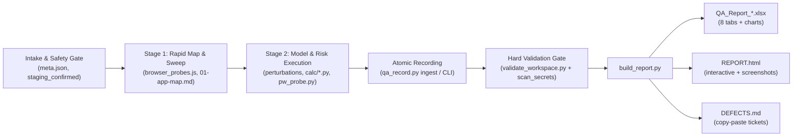

# Blackbox UI QA

**Turn any coding agent into an adversarial, evidence-backed QA engineer for web apps you can only test through the UI.**

[](SKILL.md)
[](LICENSE)
[](CHANGELOG.md)
[](requirements.txt)
[](https://affankhan007.github.io/blackbox-ui-qa/)
[](#installation)

**[View Live Sample Report](https://affankhan007.github.io/blackbox-ui-qa/)** · **[Changelog](CHANGELOG.md)** · **[Sample Deliverables](examples/README.md)** · **[Adversarial QA Gym](evals/gym/server.py)**

When source code is unavailable, generic AI "QA" turns into shallow button-clicking that misses math errors, reload data loss, async search races, and direct-URL permission bypasses—or floods you with false alarms.

`blackbox-ui-qa` gives your agent a disciplined black-box methodology, a deterministic browser telemetry sensor, optional millisecond-precision Playwright probes, a strict evidence & secret-scan validator, and three ready-to-ship deliverables.

---

## Verified Benchmark Scorecard (`evals/gym/`)

Measured against our self-contained, zero-dependency 11-bug + 2-trap [Adversarial QA Gym](evals/gym/server.py) and graded automatically with [`evals/score_gym_run.py`](evals/score_gym_run.py):

| Run Configuration | Scope | Planted-Bug Recall | False-Positive Traps | Validation & Secret Scan | Cleanup |
|---|---|---|---|---|---|
| **Restricted Webview** (`js_eval: false`) | 8-bug baseline | `7 / 8` (`87.5%`) | `0` violations | `0` errors | Restored & clean |
| **`pw_probe.py` + `browser_probes.js` + `ingest`** | 8-bug baseline | **`8 / 8` (`100.0%`)** in `24.13s` | **`0` violations** | **`0` errors** | Restored & clean |
| **Full SPA/AI Gym Suite (`v2.1.0`)** | **11 bugs** (incl. `409` rollback, `?tab=` deep-link, SSE citation) | **`11 / 11` (`100.0%`)** in `36.0s` | **`0` violations** | **`0` errors** | Restored & clean |

---

## Why `blackbox-ui-qa` Beats Ad-Hoc UI Clicking

| Failure Mode of Ad-Hoc AI QA | How `blackbox-ui-qa` Solves It |
|---|---|
| **Trusts the app's own math** | **Oracle before actual:** Computes expected totals, proration, and rounding externally in `calc/*.py` before judging UI output. |
| **Trusts a green "Saved!" toast** | **7-surface persistence:** Verifies immediate UI, hard reload, sibling lists, downstream modules/reports, exports, audit logs, and network payloads. |
| **Misses 1.5s toasts & GraphQL HTTP 200 errors** | **`browser_probes.js` telemetry:** Attaches `MutationObserver`, `fetch`/XHR hooks (SSE-safe), and DOM/WCAG audits with automatic secret redaction. |
| **Can't catch millisecond race conditions** | **`pw_probe.py` accelerator:** Optional Playwright runner triggers true concurrent search races, double-submits, reload diffs, and isolated-role URL checks. |
| **Cries wolf on ambiguous UX** | **6-way anomaly triage:** Separates `Test artifact`, `Environment/data`, `Expected variant`, `Oracle gap`, and `Observation`—only reproduced, oracle-backed bugs become `Fail`. |
| **Hand-written, unverified summaries** | **Hard validation gate:** Blocks un-evidenced `Pass`/`Fail`, `0`-byte files, unrestored settings, and leaked tokens/passwords across `.html`/`.har`/`.json`/`.txt`. |

---

## Installation

### One-Line Universal Install (`npx skills`)

Compatible with the Agent Skills specification ([`SKILL.md`](SKILL.md)):

```bash
npx skills add AffanKhan007/blackbox-ui-qa
```

### Manual Install (`install.sh` / `install.ps1`)

**Prerequisites:** Python `3.10+` with `openpyxl>=3.1` (`pip install -r requirements.txt`), plus a browser automation tool (host-native browser, Playwright MCP, Chrome DevTools MCP, or optional `pip install playwright && playwright install chromium`), or Guided Mode without a browser.

```bash
git clone https://github.com/AffanKhan007/blackbox-ui-qa.git
cd blackbox-ui-qa

./install.sh --global                 # portable ~/.agents/skills/blackbox-ui-qa
./install.sh --project --host claude  # project-local .claude/skills/blackbox-ui-qa
./install.sh --global --host all      # install to all 8 supported hosts
```

Windows PowerShell:

```powershell
.\install.ps1 -Scope Global
.\install.ps1 -Scope Project -HostName opencode
.\install.ps1 -Scope Global -HostName all
```

Supported `--host` / `-HostName` targets: `universal`, `claude`, `opencode`, `codex`, `cursor`, `windsurf`, `gemini`, `copilot`, `all`.

---

## How to Use It

Once installed, prompt your AI agent normally—it handles workspace creation, browser probing, recording, validation, and report generation automatically.

### Example Prompts

**1. Deep Staging Audit (SaaS / ERP / Billing)**
> Use `blackbox-ui-qa` to audit our staging app at `https://staging.example.com` (staging confirmed). Logins: Admin (`admin@test.com` / `...`) and Viewer (`viewer@test.com` / `...`). Scope: Orders, Settings, and Billing. Forbidden: do not send real emails or delete non-`QA_` records. Depth: Deep.

**2. Modern SPA & AI Copilot Audit**
> Run `blackbox-ui-qa` on `https://staging.board.example` (staging confirmed). Focus on optimistic toggle rollbacks on 4xx/5xx, live search races, deep-linked `?tab=` URLs across reload, mobile `390x844` layout, and AI Copilot SSE streaming + citation grounding + prompt-injection boundaries.

**3. Guided Mode (No Browser Tool Available)**
> Use `blackbox-ui-qa` in guided mode (`--mode guided`) for `https://staging.portal.example`. Attached are 2 screenshots and a note that PDF export ignored date filters last month. Produce an execution runbook without fabricating results.

### Depth Modes

| Depth | Rigor & Coverage |
|---|---|
| **`Quick`** | Navigation map, passive error/layout sweep, smoke + top P0 risks (`sampled` atlas). |
| **`Standard`** | Full navigation map, risk-targeted controls, interleaved P0/P1 flows, multi-role checks. |
| **`Deep`** *(default)* | `Standard` **plus** Ring 0/1 cross-module modeling, single-factor config perturbations (logged & restored), external `calc/*.py` math checks, 7-surface persistence, `configuration_matrix`, and 1 chartered gap-hunt loop. |
| **`Exhaustive`** | `Deep` **plus** `full` atlas accounting (every control tested or explained), pairwise config interactions, and repeated gap-hunt loops until dry. |

---

## Architecture & 3-Stage Workflow



---

## Deliverables & Live Preview

Every validated run outputs three synchronized artifacts (or an interactive Excel runbook in `--guided-sheet` mode):

1. **`REPORT.html`** — Zero-dependency, XSS-escaped interactive HTML report with KPI cards, live Module/Status/Severity/text filters, collapsible defect tickets, and inline screenshot previews ([View Live Sample Report](https://affankhan007.github.io/blackbox-ui-qa/)).
2. **`DEFECTS.md`** — Severity-sorted (`Critical` → `Enhancement`), copy-pasteable GitHub/Jira/Linear defect tickets complete with reproduction steps, linked test-case oracles, expected vs. actual, impact, and evidence paths.
3. **`QA_Report_<app>_<timestamp>.xlsx`** — Styled 8-sheet workbook (`Summary` with charts & reconciliation, `Test Cases`, `Defects`, `Coverage` including *Journey, invariant & multi-surface persistence* and *Technique* tables, `Field Atlas`, `Relationships`, `Test Data & Config`, `Open Questions`).


Inspect tracked sample outputs in [`examples/`](examples/README.md): [`demo_report.xlsx`](examples/demo_report.xlsx), [`REPORT.html`](examples/REPORT.html), and [`DEFECTS.md`](examples/DEFECTS.md). To render a local demo walkthrough video (`assets/demo.webm`, gitignored) or convert to `demo.gif` / `demo.mp4`, run [`assets/record_demo.py`](assets/record_demo.py).

---

## CLI Quick Reference

All workspace scripts live under `scripts/` (`init_workspace.py`, `qa_record.py`, `validate_workspace.py`, and `qa_diff.py` are pure Python stdlib):

```bash
# 1. Initialize workspace (local qa-* folders are gitignored)
python scripts/init_workspace.py --app "Acme HR" --url "https://staging.example.com" --module Payroll --depth deep

# 2. Optional deterministic Playwright probes (injects browser_probes.js via addInitScript)
python scripts/pw_probe.py <ws> save-auth --login-url <url>/login --user admin --password "..." --out /tmp/qa_admin.json
python scripts/pw_probe.py <ws> sweep --storage-state /tmp/qa_admin.json --url <url>/orders
python scripts/pw_probe.py <ws> a11y-keyboard --storage-state /tmp/qa_admin.json --url <url>/orders --tabs 25
python scripts/pw_probe.py <ws> exec --storage-state /tmp/qa_admin.json --file steps.json
python scripts/pw_probe.py <ws> race-search --url <url>/orders --selector "#order-search" --query-a alpha --query-b beta
python scripts/pw_probe.py <ws> double-submit --url <url>/orders --fill 'input[name="customer"]=QA_DBL' --submit-selector "#create-order-btn"
python scripts/pw_probe.py <ws> reload-check --url <url>/orders/detail?id=1 --fill "#note-input=QA_NOTE" --submit-selector '#note-form button[type="submit"]' --watch-selector "#note-display"
python scripts/pw_probe.py <ws> authz-url --login-url <url>/login --user viewer --password "..." --role viewer --target-url <url>/orders/edit?id=1

# 3. Record atomically (one-shot ingest bundle OR incremental subcommands)
python scripts/qa_record.py <ws> ingest --file bundle.json
python scripts/qa_record.py <ws> set-meta --staging-confirmed true --role admin --role viewer
python scripts/qa_record.py <ws> add-defect --from-case TC-0002 --impact "..." --likely-cause "... (hypothesis)"

# 4. Validate (blocks missing/0-byte evidence, bad refs, unrestored configs, and secrets)
python scripts/validate_workspace.py <ws> --strict

# 5. Build deliverables (.xlsx + DEFECTS.md + REPORT.html) or guided sheet round-trip
python scripts/build_report.py <ws>
python scripts/build_report.py <ws> --guided-sheet
python scripts/qa_record.py <ws> import-guided --file Guided_Execution_acme-hr.xlsx

# 6. Compare two runs across releases
python scripts/qa_diff.py <baseline_ws> <current_ws>
```

---

## Adversarial QA Gym & Development

Run the offline 11-bug + 2-trap gym locally or execute the full test suite:

```bash
# Start local mini-SaaS gym and grade a completed run
python evals/gym/server.py --port 8765
python evals/score_gym_run.py <workspace> --json

# Regenerate demo & run package/smoke tests
python examples/make_demo.py
python tests/check_skill.py
python tests/smoke_test.py
```

```text
blackbox-ui-qa/
├── SKILL.md                             # Core skill instructions & 3-stage loop
├── references/                          # Progressive-disclosure playbooks (loaded per stage)
│   ├── 01-discovery-and-modeling.md
│   ├── 02-test-design-and-lenses.md
│   ├── 03-execution-and-triage.md
│   ├── 04-report-and-schemas.md
│   ├── 05-tool-compat.md
│   └── 06-domain-packs.md
├── scripts/
│   ├── browser_probes.js                # Idempotent, SSE-safe telemetry & WCAG/layout probe
│   ├── pw_probe.py                      # Optional deterministic Playwright accelerator
│   ├── qa_common.py                     # Stdlib schema, validation, redaction & coverage kernel
│   ├── qa_record.py                     # Atomic CLI & one-shot JSON ingest / guided importer
│   ├── init_workspace.py                # Workspace scaffolder
│   ├── validate_workspace.py            # Workspace & secret-scan gate
│   ├── build_report.py                  # Generates .xlsx, DEFECTS.md, REPORT.html & guided sheet
│   └── qa_diff.py                       # Release-over-release regression diff
├── docs/index.html                      # Self-contained GitHub Pages live sample report
├── assets/                              # Social preview banner, report preview & demo capture script
├── examples/                            # Synthetic demo generator & sample deliverables
├── evals/                               # Eval prompts, offline Adversarial QA Gym & grader
├── tests/                               # Package integrity & end-to-end smoke suite
├── install.sh / install.ps1             # Cross-platform installers for 8 agent hosts
└── .github/workflows/validate.yml       # Ubuntu/Windows × Python 3.10–3.12 + Node JS check
```

## License

MIT — see [LICENSE](LICENSE).
